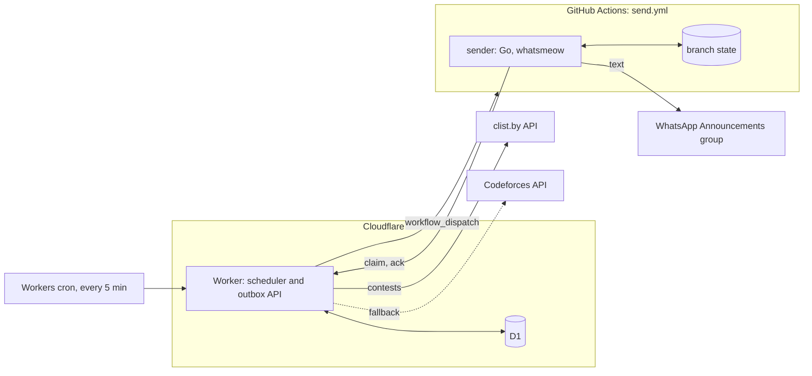
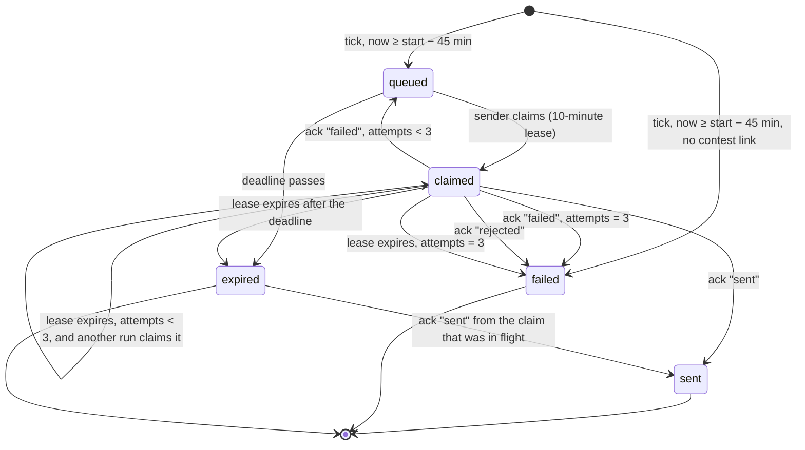
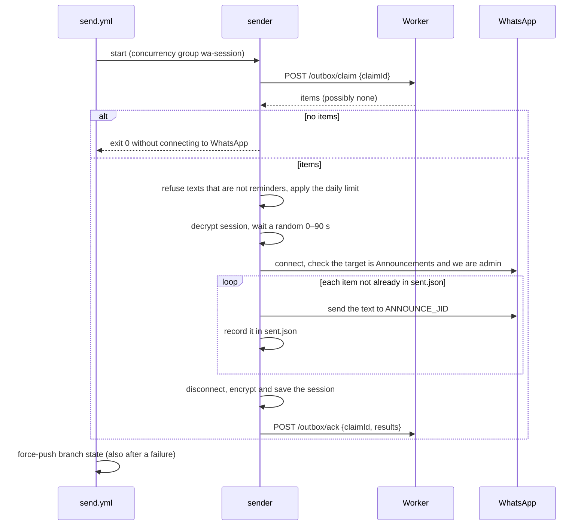

# Architecture

The bot posts a reminder for each selected programming contest into the Announcements group of a WhatsApp Community, 45 minutes before the contest starts. It runs entirely on free hosted services.

## Requirements

| | |
|---|---|
| What | One reminder per selected contest (Codeforces, CodeChef, LeetCode, AtCoder), in the community's message format ([formatter.md](formatter.md), [reminder-format.md](reminder-format.md)). |
| Where | Exactly one chat: the community's Announcements group. Never any other group or person. |
| Delivery | Effectively once: no duplicates and no silent misses. Every miss shows on the badge and in `/health`. A miss within a failed send run also arrives as GitHub's email about that run, whose job summary carries the text to post by hand unless the sender refused it; a miss without a send run (a reminder that expired before any run, or a contest without a contest link) shows only on the badge, in `/health` and in the Worker's log. |
| Cost | $0, with no credit card. |
| Volume | 1–4 messages a day. |

## Constraints

| | |
|---|---|
| WhatsApp | No official API can post into a Community's Announcements group ([research](research/official-whatsapp-apis.md)). The sender is therefore an unofficial linked device (whatsmeow) on a spare number. Its session keys rotate on every connection and must be saved after every run, and only one connection may be live at a time. |
| Cloudflare Workers Free | 10 ms CPU per invocation, 5 cron triggers per account, 100,000 requests a day [1]. |
| Cloudflare D1 Free | 5 million rows read and 100,000 rows written a day, 500 MB per database [2]. |
| GitHub Actions | A concurrency group holds at most one pending run; a newly queued run cancels and replaces the pending one [3]. |

## Product decisions and trade-offs

| Decision | Reason | Accepted trade-off |
|---|---|---|
| Post through an unofficial linked device (whatsmeow). | No official API reaches a Community's Announcements group ([research](research/official-whatsapp-apis.md)). | Unofficial clients break WhatsApp's Terms, and the account can be restricted or banned; WhatsApp publishes no thresholds ([research](research/report.md#ban-risk)). |
| The device is a dedicated spare number that is a community admin; the owner's main number stays the community owner. | A ban then costs a SIM, not the owner's personal account or the community, and a linked device can read every chat on its account, so no personal chats are exposed. | The spare phone must open WhatsApp at least every 14 days, or the device is logged out and must be paired again. |
| Reminders go to the Announcements group only, enforced by the sender, which refuses any chat that is not a community announcements group where it is admin. | Members of the community's other groups should not receive reminders. | None; reminders appear wherever the community's Announcements group is shown. |
| Contests posted: every rated Codeforces round (Div. 1 to Div. 4, Educational, Global, Hello, Good Bye and sponsored rounds), CodeChef Starters, LeetCode Weekly and Biweekly, AtCoder Beginner Contests. Every such contest is reminded, not only the ones someone would remember to post. | The contests the community follows, checked against the community's 233 manual reminders from August 2025 to November 2026 ([formatter.md](formatter.md#tests)). | Unrated Codeforces rounds (testing rounds, April Fools, ICPC mirrors), Kotlin Heroes, CodeChef Monday Munch and Placement Prep, AtCoder ARC, AGC and heuristic contests, and anything longer than 5 hours get no reminder. Members see more reminders than before, for example every Sunday 8 AM LeetCode Weekly. Changing the selection is an edit to `worker/config/rules.json`. |
| A Codeforces Div. 1 and Div. 2 pair starting together gets one reminder, named `(Div. 1 + Div. 2)`, with the Div. 2 link. | One post per contest slot, as the community posted them. | Div. 1 participants get the Div. 2 link. |
| A reminder is due exactly 45 minutes before the start, with no rounding: an 8:00 PM contest is announced at 7:15 PM and an 8:05 PM contest at 7:20 PM. | Enough notice to join, close enough to the start to be remembered. | Posts land up to about 2 minutes after the due time: the cron fires every 5 minutes, the GitHub job takes seconds to start, and the sender waits a random 0–90 seconds so its sends are not machine-regular. |
| A reminder that cannot be sent at least 10 minutes before the start is dropped and reported. | A reminder in the last minutes before a contest is noise. | An outage longer than the 35-minute window misses reminders. The badge turns red; a GitHub email arrives only when a send run itself fails, not when the Worker stops ticking or cannot start the sender. |
| The text copies the community's manual format exactly and is sent as plain text, never with a link preview. | Familiar posts; previews clutter the group. | None. |
| Codeforces reminders always link to `https://codeforces.com/contests/<id>`. | That page opens before the round starts; `/contest/<id>` opens only once it has begun. | None. |
| A reminder links only to the contest's page, in one fixed shape per platform. The Worker reads clist's link leniently (`http` or `https`, with or without `www.` or a trailing `/`, any query or fragment) and writes that shape ([formatter.md](formatter.md#contest-links)). A selected contest whose link has no such shape is not posted: it is reported ahead of time as a yellow badge and, when due, recorded as a missed reminder. | The sender accepts no other link, so such a reminder could never be posted. Whether a contest should be reminded is decided by the rules alone, so a link the formatter cannot read becomes a visible miss, never a silent skip. | That contest's reminder is missed until `contestLink` learns the new link. Every contest selected from clist's data of August 2025 to November 2026 has a contest link. |
| Tips come from pools of owner-approved lines per contest type (Div. 3, Div. 4, Educational, AtCoder Beginner Contest, morning LeetCode), one line chosen per contest from its link, plus one-off overrides; nothing is generated at send time. | The owner's voice with variety, so the same contest type does not repeat one line every time. | Contests outside those types carry no tip unless the owner adds an override. |
| The sender posts only reminders in the agreed format ([reminder-format.md](reminder-format.md)): fixed lines, a link only to a contest page of its own platform, and a contest name and tip without links, domains, IP addresses, phone numbers or invisible characters. It posts at most 8 messages in any 24 hours. | Whoever controls the Worker, its deployment or `ADMIN_TOKEN` can put text into the outbox; the sender, which holds the WhatsApp session, keeps the bot's number from posting anything but contest reminders, or bursts that risk a ban ([sender.md](sender.md#content-checks)). | The format is a contract between the formatter and the sender, written once in [reminder-format.md](reminder-format.md) and checked in both languages against shared test data; a new platform or a format change needs both changed. A text the sender refuses is not posted and not retried, so that reminder is missed and reported. The limit is counted from `sent.json`, which whoever holds `GH_TOKEN` can roll back by cancelling a run before it is saved, so it bounds bursts within the runs that complete rather than the total over time. |
| Each contest gets one reminder, ever. A contest rescheduled after its reminder was queued gets no second reminder and no correction. | Two reminders for one contest irritate members. Correcting the first is not practical: WhatsApp allows edits only within 20 minutes of sending ([whatsmeow `EditWindow`](https://pkg.go.dev/go.mau.fi/whatsmeow#pkg-constants)), which ends 25 minutes before the start, earlier than most delays are announced. | A reminder can show an outdated start time when a contest is delayed after it was posted. In the community's history, 8 of 230 reminders (3.5%) were for contests that started 10 to 15 minutes after the posted time. |
| Contest names are taken as clist reports them when the reminder is queued, made valid free text: invisible characters removed, domains defused so they are not links, at most 200 code points, and `<Platform> contest` for a name that cannot be made valid ([formatter.md](formatter.md#contest-names)). | Rounds are usually named well before they start, and the snapshot refreshes hourly. | A round still under a placeholder name ("Codeforces Round (Div. 2)") is announced under it. |
| clist.by is the contest source, with the Codeforces API as the only fallback. | One authenticated call covers all four platforms; Codeforces has an official keyless API. | While clist is down, CodeChef, LeetCode and AtCoder reminders rely on the last snapshot, so contests added during the outage are missed; the badge turns yellow. |
| Everything runs on free tiers: Cloudflare Workers and D1 schedule, GitHub Actions sends. | $0 with no card. | GitHub's terms exclude runners for work "unrelated to" the software project, which a notifier arguably is; runners connect from datacenter addresses, which reports associate with more WhatsApp restrictions ([research](research/free-hosting.md)). |
| A failed send is retried by later runs, up to 3 claims per reminder and until its deadline, then reported; there is no paid fallback. | Most failures (a slow connection, a dropped run) clear on the next run. | When the session is logged out, every reminder misses until the number is paired again; the failure email carries each text to post by hand. |
| The bot covers contests on Codeforces, CodeChef, LeetCode and AtCoder only. Other events (college contests, hackathons, other platforms) are posted by hand. | Those events are one-offs with registration details that differ each time; the community posted a handful in 15 months. | Someone has to post them; they do not appear in `/preview`. |
| The code is public in `mitaoe/cp-reminders`, where anyone can propose changes. Its `main` changes only through pull requests whose CI checks pass; force pushes and deletion of `main` are blocked, and `.github/CODEOWNERS` requests a review from @adityakotkar47 on every pull request opened by another account, except while it is a draft. The bot runs from a fork, the deployment repository, which alone holds its secrets and branch `state`. A release is a Sync fork of the deployment repository after @adityakotkar47 checks the compare view between the fork's `main` and `mitaoe/cp-reminders` `main` ([README](../README.md#where-it-runs)). | Contributions are reviewed before they can run anywhere with a secret: anyone with write access to a repository can run its workflows from their own branch, and a workflow can read every secret of its repository, so no secret is stored in the repository people contribute to. The sender redacts WhatsApp IDs, in the forms whatsmeow and libsignal write them, from its logs and from the errors in its job summary ([sender.md](sender.md#public-output)), and GitHub masks secrets in logs. | Every workflow on the fork can read the bot's secrets. `deploy.yml` runs pnpm, Wrangler and the locked dependencies with the Cloudflare token, applies `worker/migrations` to the production D1 database and deploys a Worker that holds its own secrets, so the check before a release covers every changed file. Sync fork brings over whatever is on `mitaoe/cp-reminders` `main` at that moment. GitHub never requests a review from a pull request's own author, and no approval is required, so @adityakotkar47 merges his own pull requests once CI passes. Every version of `session.db.age` that branch `state` ever held stays downloadable by commit ID, from the fork and through `mitaoe/cp-reminders`, since forks share git objects. Each is encrypted to `AGE_IDENTITY` and unreadable without it, and holds the keys of the linked device it belongs to; the session key is rotated by pairing a new device with a new key and logging out the old one, which makes the old sessions useless. |
| The Worker serves its API on its public `workers.dev` address, without a rate limit. | No custom domain or paid plan is needed; every route that changes anything requires a token. | Anyone can send requests to that address. The Workers Free plan allows 100,000 requests a day per Cloudflare account, shared with every other Worker on the account; once a flood uses them up, the Worker stops answering until 00:00 UTC, so reminders due before then are missed. The badge and `/health` stop answering too, which makes it visible. A custom domain with a Cloudflare WAF rate-limiting rule would stop such requests before they count. |
| The sender authenticates to the Worker with `SENDER_TOKEN` alone, and the Worker trusts its acknowledgements. | The token exists only as a Worker secret and a secret of the deployment repository, where every workflow is already trusted with the bot's other secrets. | Whoever holds `SENDER_TOKEN` can claim reminders and acknowledge them as `sent` without posting them; those reminders are missed and the badge stays green. |

## Components



| Component | Responsibility | Never |
|---|---|---|
| Core (`worker/src/core/`) | Pure functions: select contests, decide which reminders are due, render the text, check free text. | Performs I/O. |
| Worker (`worker/`) | Fetches and caches contests, queues due reminders, wakes the sender, serves the outbox, reports health and a status badge. | Talks to WhatsApp or knows the target chat. |
| Sender (`sender/`) | Claims queued reminders, checks that each is a reminder in the agreed format, posts it to the one allowed chat, reports results, saves the WhatsApp session. | Decides what to send or when, accepts a destination over the network, or posts a text that is not a reminder. |
| Workflows (`.github/workflows/`) | In the deployment repository: `send.yml` runs the sender with its secrets, one run at a time, and saves its state; `deploy.yml` deploys the Worker. In every repository: `ci.yml` runs the checks. | Carry message text: the dispatch is only a wake-up. |

## Design decisions

1. **The sender pulls from an outbox.** The Worker writes due reminders to a durable outbox in D1, and a dispatch only means "wake up and drain it". Every run drains everything pending, so a cancelled or dropped run loses nothing, and message text never appears in workflow inputs or logs.
2. **State lives in D1, not KV.** Deduplication and claiming need atomic, read-your-writes operations: `INSERT … ON CONFLICT DO NOTHING`, `UPDATE … RETURNING`, and `batch()`, which runs as one transaction [4]. KV changes can take 60 seconds or more to reach other locations [5], and its free tier allows 1,000 writes a day. D1's documentation promises general SQLite compatibility rather than these statements by name [6], so the Worker tests run them against the local D1 engine.
3. **Contests have a natural identity.** A contest is `(resource_id, href)`, the same whichever source supplied it, and a reminder's key is `resource_id|href`, so a contest is reminded at most once, even when its start time changes.
4. **Text is rendered once, when the reminder is queued.** The stored text is exactly what is sent, which makes the outbox an audit log.
5. **The sender decides what may be posted, and where.** `ANNOUNCE_JID` is a secret of the deployment repository, and the sender refuses any chat that is not a community announcements group in which it is admin. Every text must parse as a reminder in the agreed format ([reminder-format.md](reminder-format.md)), and at most 8 are posted in any 24 hours. A compromised Worker can therefore at most post contest reminders, with links only to contest pages of the four platforms, into Announcements.
6. **Two independent guards against duplicates.** D1's primary key on the reminder key, and the sender's own `sent.json`, which covers a message that was sent but whose acknowledgement was lost.
7. **The session lives on a single-commit branch.** Branch `state` of the deployment repository holds `session.db.age` and `sent.json`. Each run force-pushes one commit with a lease check, so the repository does not grow, and the workflow's concurrency group serialises the writes. The push happens in a separate job that takes only the two files from the sender's job, so the only token that writes to the repository never runs alongside the sender's code ([workflow.md](workflow.md#sendyml-drain-the-outbox)).

## Data

All timestamps are stored in UTC as ISO 8601 with `Z`. IST appears only in the rendered text.

### D1 tables

Schema: [`worker/migrations/0001_init.sql`](../worker/migrations/0001_init.sql).

| Table | Role | Shape |
|---|---|---|
| `contest_snapshot` | Cache of upcoming contests | One row, replaced as a whole on each refresh. `payload` is the normalised `Contest[]` JSON. |
| `reminders` | Outbox and audit log | One row per reminder, created when it becomes due and kept indefinitely (about 1,000 rows a year). The source of truth for "already handled". |
| `tip_overrides` | One-off tips | Set at runtime without a redeploy; they take precedence over the overrides in `worker/config/tips.json`. A stored tip that is not valid free text is ignored when tips are loaded, and the Worker logs it. |
| `meta` | Operational facts | The outcome of each tick step: `last_tick_at`; `last_fetch_at`, `last_fetch_source`, `last_fetch_error`, `unlinked_contests`; `last_wake_at`, `last_wake_error`. An error key is set when its step fails and removed when the step next succeeds. It holds only a code (see [Error codes](#error-codes)), never upstream text. `unlinked_contests` is the number of selected contests in the latest snapshot whose deadline is still ahead and that have no contest link; it is set at each refresh and removed when the number is 0. |

A reminder's `deadline_utc` is its start minus `minLeadMinutes` (10). After the deadline it is not worth sending.

### Reminder lifecycle



The tick creates every row. A due contest that has a contest link is queued with its rendered text. A due contest without one ([formatter.md](formatter.md#contest-links)) is created `failed`, with `last_error` `no_contest_link`, no text and no attempts: it can never be posted, the primary key keeps it to one row per contest, and as a miss it is reported like any other. The schema needs no change for this, since `text` may be empty and `failed` is a valid status.

Only the Worker changes a row's status, in two places:

- **Acknowledgement** (`POST /outbox/ack`): the sender reports a status for each item it claimed; results from any other claim are ignored. `sent` marks the row sent. `failed` means a valid reminder was not delivered: the row returns to `queued` while attempts remain, and becomes `failed` after the last. `rejected` means the sender refused the text ([reminder-format.md](reminder-format.md)): the row becomes `failed` at once, since the same text would be refused again.
- **Sweep**: runs in every tick and at the start of every claim, in the same transaction as the claim. It expires `queued` rows past their deadline, expires `claimed` rows whose lease has run out after the deadline, and fails `claimed` rows whose lease has run out after the last attempt.

`attempts` counts claims: it rises when a run claims the row, so a run that dies without acknowledging also uses one. Its row stays `claimed` with the old lease, and the next claim takes it over once the lease has run out. A `claimed` row past its deadline is left alone until its lease runs out, so a run that is still sending can report `sent`.

`failed` and `expired` are terminal and count as misses: they appear in `/health` and turn the badge red. A miss in a send run also fails the workflow run, which emails the owner with the text of every valid unsent reminder in its job summary; a `no_contest_link` row never reaches a send run, so it is shown by the badge, `/health` and the Worker's log.

| Column | Set when |
|---|---|
| `created_at` | The tick queues the reminder. |
| `start_utc`, `deadline_utc` | At queueing: the contest start, and the start minus `minLeadMinutes`. |
| `claimed_at`, `claim_id` | A run claims it; cleared when a failed attempt returns it to `queued`. |
| `attempts` | Each claim. |
| `sent_at`, `message_id` | The `sent` acknowledgement; `message_id` is WhatsApp's message ID. |
| `last_error` | A `failed` or `rejected` acknowledgement, a lease that runs out after the last attempt, or `no_contest_link` at creation. |
| `updated_at` | Every change; for a `failed` or `expired` row, the time it became so. |

A row holds the latest state, not a history of every transition: a reminder that failed once and was then sent shows `sent`, two attempts and the last error. Each run's own timeline is in its GitHub Actions log, and `sent.json` records when the sender delivered each message.

### Configuration

`worker/config/rules.json` (which contests, lead times) and `worker/config/tips.json` (tip rules) are bundled into the Worker at deploy. Both are described in [formatter.md](formatter.md).

### Sender state (branch `state`)

| File | Content |
|---|---|
| `session.db.age` | The WhatsApp login: the whatsmeow SQLite store, encrypted with age. The decryption key is the secret `AGE_IDENTITY`, never stored in a repository, so the file is unreadable without it. Each run decrypts it, connects, and commits the re-encrypted file, because the keys inside change on every connection. |
| `sent.json` | The last 500 reminders this sender delivered: `{key, sentAt, messageId}`. Not secret. The daily limit is counted from it. |

### Shared test data (`testdata/`)

| File | Content |
|---|---|
| `reminders.json` | Every reminder the formatter renders for the contests in the Worker's fixtures, with the configured tips, and for synthetic contests with hostile names. The Worker's tests keep it equal to the formatter's output, and the sender's tests require every text in it to parse. |
| `free-text.json` | Safe and unsafe free-text examples that the Worker's and the sender's free-text checks must classify the same way. |

Both are described in [reminder-format.md](reminder-format.md#shared-test-data).

### Secrets

| Stored in | Name | Use |
|---|---|---|
| Worker | `CLIST_USERNAME`, `CLIST_API_KEY` | clist API |
| Worker | `GH_TOKEN` | Fine-grained token limited to the deployment repository with Actions read and write; dispatches `send.yml`. |
| Worker | `TICK_TOKEN` | `POST /tick` |
| Worker | `ADMIN_TOKEN` | `GET /preview`, `PUT /tips`, `DELETE /tips` |
| Worker and deployment repository | `SENDER_TOKEN` | `/outbox/claim`, `/outbox/ack` |
| Deployment repository | `WORKER_URL` | Base URL of the Worker |
| Deployment repository | `AGE_IDENTITY` | Decrypts and encrypts the session |
| Deployment repository | `ANNOUNCE_JID` | The only chat the sender may post to |
| Deployment repository | `CLOUDFLARE_API_TOKEN`, `CLOUDFLARE_ACCOUNT_ID` | `deploy.yml`: an API token from Cloudflare's "Edit Cloudflare Workers" template with D1 Edit added, and the account ID |

Every token has one purpose and is compared in constant time. The deployment repository also has the variable `BOT_DEPLOYMENT=true`, which enables `send.yml` and `deploy.yml`; `mitaoe/cp-reminders` has no secrets and no such variable. The Worker's `vars.GH_REPO` in `wrangler.jsonc` names the deployment repository. How to create and rotate each secret is in the [README](../README.md#secrets).

## Interfaces

### Worker HTTP API

Bodies are JSON. Authentication is `Authorization: Bearer <token>`.

| Route | Auth | Behaviour |
|---|---|---|
| `GET /health` | none | `{lastTickAt, lastFetchAt, lastFetchSource, lastFetchError, lastWakeError, queued, claimed, failed24h, expired24h, unlinkedContests}`. The two errors are codes ([Error codes](#error-codes)); `unlinkedContests` is `unlinked_contests`, or 0. Contains no secrets, no message text and no upstream response text. |
| `GET /badge` | none | The health as a [shields.io endpoint badge](https://shields.io/badges/endpoint-badge) (see [Status badge](#status-badge)). |
| `POST /tick` | `TICK_TOKEN` | Runs one tick and returns `{fetched, queued, woke, errors}`. |
| `GET /preview` | `ADMIN_TOKEN` | The next 10 reminders with their send time in IST and rendered text; a contest without a contest link is shown as a reminder that will be recorded as failed. |
| `PUT /tips` | `ADMIN_TOKEN` | `{href, tip}` sets a one-off tip, which must be free text as [reminder-format.md](reminder-format.md#free-text) defines it; an empty `tip` suppresses the tip for that contest. |
| `DELETE /tips` | `ADMIN_TOKEN` | `{href}` removes a one-off tip. |
| `POST /outbox/claim` | `SENDER_TOKEN` | `{claimId}` → `{items: [{key, text, startUtc, deadlineUtc}]}`, at most 5. Atomically moves `queued` rows, and `claimed` rows whose lease has expired, to `claimed` under `claimId`. Rows past their deadline are not returned. |
| `POST /outbox/ack` | `SENDER_TOKEN` | `{claimId, results: [{key, status: "sent" \| "failed" \| "rejected", messageId?, error?}]}` applies the lifecycle transitions ([Reminder lifecycle](#reminder-lifecycle)). Results for rows held by another claim are ignored. |

### Status badge

`GET /badge` returns `{schemaVersion: 1, label: "bot", labelColor: "2f373f", message, color}` with `Cache-Control: max-age=300`. The states are ordered by what to fix first, and the first matching state wins:

| State | Condition | `message` | `color` |
|---|---|---|---|
| down | no readable tick time, or none in the last 15 minutes | `never ticked` / `no tick for 23m` | `de2a39` (red) |
| sender unreachable | `lastWakeError` is set | `dispatch failing` | `de2a39` (red) |
| failing | `failed24h + expired24h > 0` | `2 missed in 24h` | `de2a39` (red) |
| unlinked contest | `unlinkedContests > 0` | `degraded: contest link` | `dbab09` (yellow) |
| degraded | `lastFetchError` is set | `degraded: clist` | `dbab09` (yellow) |
| healthy | otherwise | `ok` | `29c64d` (green) |

A contest without a contest link comes before a failing clist: it is a certain miss once that contest is due, and only a change to the formatter prevents it, while a clist failure is covered by the Codeforces fallback and the last snapshot and usually clears by itself.

The README shows the badge next to GitHub's workflow badge, so the label, green and red match it. GitHub draws vertical gradients (label `#444D56` to `#24292E`, passing `#34D058` to `#28A745`, failing `#D73A49` to `#CB2431`), while shields.io's flat style paints one colour under an overlay that adds 10% `#bbb` at the top and 10% black at the bottom. Each colour is chosen so that, under that overlay, it averages to the middle of GitHub's gradient. GitHub's workflow badge has no warning state; degraded uses Primer's yellow `dbab09`.

The healthy message carries no time. The README image can be up to two cache periods old: the Worker sends `max-age=300`, and shields.io caches the rendered image for another 300 seconds (`max-age=300, s-maxage=300`). Green already means the last tick is at most 15 minutes old.

A tick that cannot start the sender turns the badge red at once, before any reminder is missed. It stays red until a dispatch succeeds, so a fault that outlasts its reminders stays visible. A single transient GitHub error clears on the next tick, which retries the dispatch. The badge carries no error; `/health` has its code.

### Error codes

`last_fetch_error`, `last_wake_error` and the matching `/health` fields hold a code from a fixed set, so upstream response text, such as GitHub's reason for refusing a token, never becomes public:

| Code | Cause |
|---|---|
| `HTTP <status>` | The upstream service answered with a status outside 2xx. |
| `timeout` | The request did not finish within 8 seconds. |
| `network error` | The request got no answer, for example a failed connection or name lookup; also any failure not listed here. |
| `invalid response` | The body was not valid JSON or had no contest list, or Codeforces reported a failure. |
| `no contests` | clist or Codeforces returned no upcoming contests. |

`last_fetch_error` names each source that failed, such as `clist: HTTP 502` or `clist: timeout; codeforces: HTTP 503`; `last_wake_error` is the code alone. The full error, including up to 200 characters of the response body for a failed dispatch, is written to the Worker's log, which Workers Logs keeps (`observability` in `wrangler.jsonc`) and `wrangler tail` streams, and is returned by `POST /tick`, which requires `TICK_TOKEN`.

The README shows it through `https://img.shields.io/endpoint?url=<WORKER_URL>/badge&logo=cloudflare&logoColor=959da5` [9], whose logo colour is the grey of GitHub's logo on its badge. The URL sets no `labelColor` or `color`, which would override the endpoint's.

### Workflow dispatch

`POST /repos/{owner}/{repo}/actions/workflows/send.yml/dispatches` with `{"ref": "main"}` and no inputs. GitHub answers `200` with the run ID [7]; the Worker treats any 2xx as success. `send.yml` has no `schedule` trigger, so GitHub's 60-day inactivity rule, which applies to scheduled workflows, does not disable it [8].

### Sender CLI

`wa keygen`, `wa pair`, `wa groups` and `wa drain`, described in [sender.md](sender.md).

## Flows

### Tick (Workers cron, every 5 minutes)

1. If the contest snapshot is older than 60 minutes, fetch clist: every upcoming contest of the four platforms, up to 100, which covers everything announced, usually several weeks ahead. If clist fails or returns nothing, fetch the Codeforces API instead, which needs no key: its contests replace the Codeforces ones in the snapshot, and the other platforms' upcoming contests are kept. `last_fetch_error` records the clist failure even when the fallback succeeds. Each refresh also sets `unlinked_contests` to the number of selected contests in the new snapshot that have no contest link. If both fail, the existing snapshot stays.
2. For every selected contest starting between 45 and 10 minutes from now whose key is not in the outbox yet, render the text and insert it as `queued` with `INSERT … ON CONFLICT(key) DO NOTHING`; a contest without a contest link is inserted the same way as `failed` with `no_contest_link` and no text.
3. Mark `queued` and `claimed` rows past their deadline as `expired`.
4. If rows are waiting (`queued`, or `claimed` with an expired lease) and the last wake was more than 4 minutes ago, dispatch `send.yml`. A 2xx response records `last_wake_at` and removes `last_wake_error`; any other outcome records `last_wake_error`.

The two intervals do different jobs. The snapshot is refreshed hourly because contest schedules change rarely and clist asks for caching. The tick runs every 5 minutes because it decides when a reminder goes out: a reminder is queued at most 5 minutes after it becomes due, and checking the snapshot costs one query.

`POST /tick` runs the same steps, so an external scheduler such as cron-job.org can act as a second trigger. Overlapping ticks are harmless: inserts are idempotent, and an extra wake only produces a run that finds an empty outbox.

### Send run



## Failure handling

| Failure | Effect | Handling |
|---|---|---|
| clist down or rate-limited | No fresh contest data | Codeforces fallback; contests already in the snapshot are still reminded. Shown by `/health` and a yellow badge. |
| Cron tick late or skipped | Reminder delayed | A reminder stays sendable from 45 to 10 minutes before the start, so ticks can be up to 35 minutes late. The badge turns red after 15 minutes without a tick. |
| Dispatch fails (GitHub error, revoked or wrong `GH_TOKEN`) | Sender not woken; no run starts, so GitHub sends no email | `last_wake_error` turns the badge red at once and `/health` shows its code, such as `HTTP 401`; the Worker's log and `POST /tick` show GitHub's full answer. `last_wake_at` stays unchanged, so every tick dispatches again until one succeeds. |
| Pending run cancelled by a newer one | None | The outbox keeps the rows; the next run drains them. |
| Two runs at once | Prevented | Concurrency group `wa-session`. One live connection is also what WhatsApp expects of a device. |
| Sent, but the ack is lost | Risk of a duplicate | The next run finds the key in `sent.json` and acks it as sent without resending. If the deadline passes first, the row ends `expired` although the message was delivered; `sent.json` is the record of delivery. |
| Text refused by the sender | That reminder is not posted | The sender acknowledges it as `rejected` with the reason, and the run fails, so GitHub emails the owner. The Worker marks it `failed` at once, without another attempt, and the badge turns red. The job summary lists its key and reason but not its text, which must not be posted. The cause is a formatter change that breaks the contract, which the shared test data catches before release, or text that did not come from the formatter. |
| Daily limit reached | Further reminders are held back | The held-back reminders are acknowledged as `failed` ("daily limit") and the run fails, so GitHub emails the owner with their texts. Each hold uses one of the 3 attempts: later runs send them while attempts remain and the deadline has not passed, otherwise they end `failed` or `expired` and are reported as misses. |
| WhatsApp session logged out or removed | Nothing can be sent | The run fails, GitHub emails the owner, and the job summary lists the texts. Rows return to `queued` while attempts remain, and end `failed` after the third or `expired` at their deadline, whichever comes first. Re-pair with `wa pair`. |
| Contest rescheduled | Start time changes | Before its reminder is queued: the reminder follows the new start. After: the key already exists, so nothing more is sent and the posted time stands. |
| Placeholder contest name | Generic name posted | The snapshot refreshes hourly, so names are usually final by the time a reminder is due. |
| Contest name that cannot be made valid free text | `<Platform> contest` posted as the name | The Worker logs `contest name replaced by the fallback name: <key>`; the reminder is sent as usual. |
| Upcoming selected contest without a contest link | Its reminder will be missed | Each snapshot refresh counts such contests in `unlinked_contests` and logs the count; `/health` shows `unlinkedContests` and the badge turns yellow (`degraded: contest link`) while the contest is still ahead. No email is sent, since no send run fails. Teach `contestLink` the new link shape and release it before the contest is due. |
| Due contest without a contest link | That reminder is not posted | The tick creates its row as `failed` with `no_contest_link` and no text, once per contest, and logs `no contest link: <key>`; it is not dispatched to the sender. It counts in `failed24h`, the badge turns red, and the row stays in the audit log. Post the reminder by hand if it matters. |
| Spare number banned | No reminders | The owner's main number owns the community; pair another number and make it admin. |

## Capacity

| Resource | Use per day | Free limit |
|---|---|---|
| Worker requests | 288 cron ticks, plus sender and badge requests | 100,000 |
| Worker CPU per tick | Parsing about 30 contests and rendering a few messages; fetches and SQL are I/O, not CPU | 10 ms |
| D1 rows written | about 24 snapshot refreshes, a few reminder transitions, 288 tick timestamps | 100,000 |
| D1 rows read | about 2,000 | 5,000,000 |
| clist requests | at most 24 | 10 a minute |
| GitHub Actions | 1–4 send runs of under a minute each, plus a deploy per release | Unlimited minutes on standard runners for public repositories |

## Repository layout

```
worker/              Cloudflare Worker (pnpm workspace package)
  config/            rules.json, tips.json
  migrations/        D1 schema
  scripts/           render-contract.ts, which writes testdata/reminders.json
  src/core/          contest selection, message formatting and free-text rules
  src/               scheduler, outbox API, health, badge
  test/              Worker tests in the Workers runtime with a local D1
  test/core/         rule tests, golden tests against the manual reminder history, contract tests
  test/fixtures/     frozen clist data and the community's manual reminders, August 2025 to November 2026
sender/              Go module: cmd/wa, internal/{drain,outbox,redact,reminder,state,wa}
testdata/            test data shared by the Worker and the sender: reminders.json, free-text.json
.github/workflows/   send.yml (drain the outbox), deploy.yml (deploy the Worker), ci.yml (checks)
docs/                architecture, reminder format, formatter, scheduler, sender, workflow
docs/research/       research behind the design
```

## Alternative host

The outbox API does not depend on GitHub Actions. A sender with a polling loop, running permanently on an always-free VM such as Oracle Cloud's, could call `/outbox/claim` every minute instead of being woken by a dispatch; the Worker, data model and API would stay the same. The sender has no polling mode today.

## References

1. Cloudflare Workers limits: https://developers.cloudflare.com/workers/platform/limits/
2. D1 pricing and limits: https://developers.cloudflare.com/d1/platform/pricing/, https://developers.cloudflare.com/d1/platform/limits/
3. GitHub Actions concurrency: https://docs.github.com/en/actions/writing-workflows/choosing-what-your-workflow-does/control-the-concurrency-of-workflows-and-jobs
4. D1 `batch()`: https://developers.cloudflare.com/d1/worker-api/d1-database/
5. How KV works: https://developers.cloudflare.com/kv/concepts/how-kv-works/
6. D1 SQL statements: https://developers.cloudflare.com/d1/sql-api/sql-statements/
7. Create a workflow dispatch event: https://docs.github.com/en/rest/actions/workflows#create-a-workflow-dispatch-event
8. Disabling and enabling a workflow: https://docs.github.com/en/actions/managing-workflow-runs-and-deployments/managing-workflow-runs/disabling-and-enabling-a-workflow
9. shields.io endpoint badge: https://shields.io/badges/endpoint-badge
